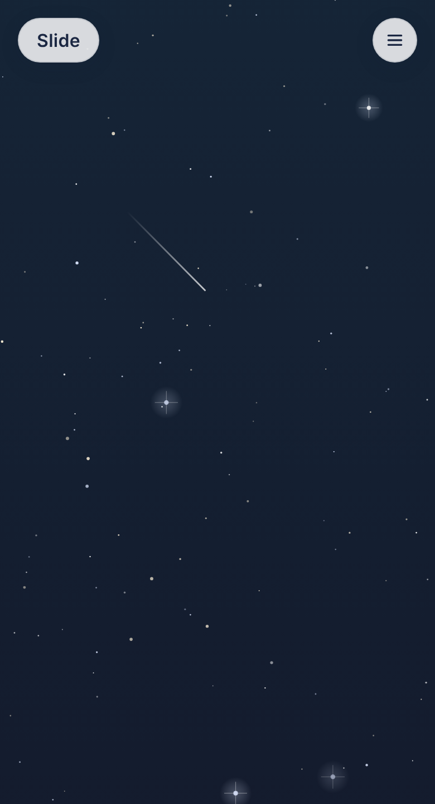

# Slide

**A calming scroll, open it instead of social or shopping apps.**

Slide is a tiny "digital pacifier" for people who reach for their phone out of habit.
When you feel the pull to open a social or shopping app, open Slide instead: a calming, quiet
scroll through soothing backgrounds. No feed, no ads, no notifications, nothing to
catch up on. Your thumb gets its scroll, your mind gets a break.

**Try it at [slide.gruvw.com](https://slide.gruvw.com)**

<p align="center">
  
</p>

## Features

- Eight calm backgrounds: Night, Dawn, Petals, Glow, Leaves, Hills, Sand and Tide
- Endless vertical scroll
- Your background choice is remembered on the device (`localStorage`)
- Installable as an app (PWA) and works offline
- Desktop layout with the about text and background picker as side bars
- Light and dark interface, respects reduced motion

## Run locally

It's a static site, no build step. Serve the folder with any static server:

```sh
python3 -m http.server 8000
# then open http://localhost:8000
```
